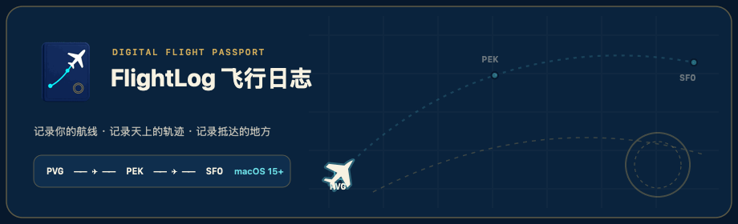

# FlightLog 飞行日志



> 一个突发奇想的 vibecoding 产物。FlightLog 飞行日志，可以记录你的航线，记录天上的轨迹，记录抵达的地方。

一款离线优先的 macOS 数字飞行护照应用，使用 SwiftUI、SwiftData、MapKit 与 Swift Charts 构建（支持 macOS 15+）。

## 下载与安装

- **直接下载安装包（Apple Silicon / M 系列芯片）**：[**FlightLog-macOS-arm64.zip**](https://github.com/Mukayi/flightlog/raw/main/Releases/FlightLog-macOS-arm64.zip)
- 解压后将 `FlightLog.app` 拖入 `/Applications`（应用程序）即可。
- *注：应用使用本地开源构建（未绑定付费 Apple 开发者公证），首次打开若提示无法验证开发者，请在「系统设置 → 隐私与安全性」中点击“仍要打开”，或在终端执行 `xattr -cr /Applications/FlightLog.app`。*

## 核心功能

- **飞行护照与登机牌**：录入、编辑、筛选每一次航班，按起降机场时区保留当地时刻与历史记录。
- **离线全球机场库**：内置全球机场数据，支持 IATA / ICAO 代码、英文名及中文城市与机场名检索。
- **航线地图与统计**：在地图上绘制大圆航线轨迹，查看年度趋势、常去机场、常乘航司与里程统计。
- **多用户与共同旅程对比**：支持创建和切换本地用户档案，将朋友或伴侣的行程导入对比，查看共同航班、共同航线、共同抵达的城市与叠加航线图。
- **本地存储与无损备份**：所有数据仅保存在本机，支持 CSV 与 JSON 导入导出。
- **联网航班查询（可选）**：支持配置 AeroDataBox（RapidAPI）API Key，按航班号与日期自动查询并填充航线信息（Key 仅保存在 macOS 钥匙串中）。

## 快捷键

- `⌘N`：新增航班
- `⌘F`：搜索航班
- `⌘1` – `⌘6`：切换概览、航班、地图、统计、设置、对比

## 运行与打包

**在 Xcode 中运行**

```sh
open -a Xcode Package.swift
```

**打包本地应用（`.app`）**

```sh
./scripts/build_app.sh
open dist/FlightLog.app
```

可将生成的 `dist/FlightLog.app` 拖入 `/Applications` 日常使用。

**运行测试**

```sh
swift test
```

## 开源协议与数据声明

- 源代码基于 [MIT License](LICENSE) 开源。
- 内置离线机场数据与时区边界遵循各自的开放许可（OurAirports Public Domain、Wikidata CC0 1.0、OpenStreetMap / timezone-boundary-builder ODbL），详见 [`AIRPORT_DATA_LICENSE.md`](Sources/FlightLog/Resources/AIRPORT_DATA_LICENSE.md)。
